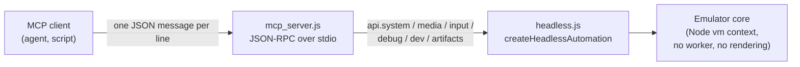

# jsA8E MCP server

`mcp_server.js` lets an AI agent (or any script that speaks the Model Context
Protocol) drive a complete jsA8E machine without a browser: boot ROMs, mount
disks, assemble and run code, type on the keyboard, read memory, step the CPU
and capture screenshots.

It is a thin adapter. It owns no emulation logic: every call is forwarded to
the same grouped automation API that the browser exposes as
`window.A8EAutomation` (see [AUTOMATION.md](../jsA8E/AUTOMATION.md) for the meaning of
each method).



Related files:

| File | Role |
|---|---|
| `mcp_server.js` | Protocol handling, tool definitions, argument mapping, result shaping |
| `headless.js` | Browser-less runtime the server drives (also usable directly from Node) |
| `js/app/automation_api.js`, `js/app/automation/*.js` | The automation API itself |
| `tests/mcp_server.test.js` | Protocol and argument-mapping tests (uses a stub runtime) |

## Starting the server

```sh
cd jsA8E
npm run mcp                      # same as: node mcp_server.js
node mcp_server.js --os-rom ATARIXL.ROM --basic-rom ATARIBAS.ROM
```

The server speaks on **stdin/stdout**; there is no network listener. Stdout is
reserved for protocol messages (one JSON object per line). Fatal start-up
errors go to stderr. When stdin closes, or on `SIGINT`/`SIGTERM`, the runtime is
disposed and the process exits (set `JSA8E_MCP_NO_EXIT=1` to keep the process
alive after disposal, which is only useful for tests).

### Command-line options

| Option | Default | Meaning |
|---|---|---|
| `--cwd <dir>` | repository root (the parent of `jsA8E/`) | Base directory for relative file paths in tool arguments and for ROM lookup. File arguments are confined to it (see Security) |
| `--os-rom <file>` | see below | OS ROM image |
| `--basic-rom <file>` | see below | BASIC ROM image |
| `--turbo` / `--no-turbo` | turbo on | Run the CPU as fast as possible instead of real time |
| `--skip-rendering` / `--rendering` | skip | Rendering is skipped unless you ask for it; screenshots still work |
| `--audio-enabled` / `--no-audio` | audio off | Audio output |
| `--no-sio-turbo` | SIO turbo on | Disable the fast SIO disk path (use for timing-sensitive loaders) |
| `--option-on-start` | off | Hold OPTION during boot (disables BASIC on XL/XE) |
| `--keyboard-mapping-mode <translated\|original>` | `translated` | How host characters map to Atari keys in `typeText` |
| `--frame-delay-ms <n>` | `0` | Pause between emulated frames |
| `--allow-any-path` | confined | Lift the confinement of file arguments to `--cwd` |
| `--no-network` | network allowed | Refuse every `*FromUrl` action |

### ROM lookup

The emulator needs ROMs that the repository does not ship. For each ROM the
server uses, in order: the command-line option, the environment variable
(`JSA8E_OS_ROM`, `JSA8E_BASIC_ROM`), then `ATARIXL.ROM` / `ATARIBAS.ROM` in the
**repository root** (not in `jsA8E/`). If your ROMs live in `jsA8E/`, pass
`--os-rom` and `--basic-rom`, otherwise the machine starts without ROMs
(`getSystemState().roms.osLoaded` is `false`) and nothing boots. ROMs can also
be loaded later with `media.loadOsRom` / `media.loadBasicRom`.

### Registering it in an MCP client

Any client that can launch a stdio server works. The configuration is the usual
command plus arguments, for example:

```json
{
  "mcpServers": {
    "jsa8e": {
      "command": "node",
      "args": [
        "/path/to/A8E/jsA8E/mcp_server.js",
        "--os-rom", "/path/to/ATARIXL.ROM",
        "--basic-rom", "/path/to/ATARIBAS.ROM"
      ]
    }
  }
}
```

With Claude Code the equivalent is
`claude mcp add jsa8e -- node /path/to/A8E/jsA8E/mcp_server.js --os-rom ...`.
Use absolute paths, because the client chooses the working directory.

## Protocol

Transport: newline-delimited JSON-RPC 2.0 on stdin/stdout. A line may also hold
a JSON array, which is handled as a batch and answered with an array.

Supported protocol versions: `2025-11-25`, `2025-06-18`, `2025-03-26`,
`2024-11-05`. The `initialize` request must name one of them, otherwise the
server answers error `-32602` and lists the supported versions.

| Method | Behavior |
|---|---|
| `initialize` | Required first. Returns `serverInfo` (`jsA8E MCP` plus the runtime version), `capabilities: { tools: { listChanged: false } }` and short usage instructions |
| `initialized` | Accepted, no response |
| `tools/list` | Lists the three tools below |
| `tools/call` | Runs a tool |
| `shutdown` | Disposes the runtime and answers `{}` |

Anything else is answered with `-32601 Unknown method`. Calls other than
`initialize` before initialization fail with `-32002`. Malformed JSON gets
`-32700` with `id: null`.

Two behaviors that matter for client authors:

- **Requests run concurrently.** The server does not queue lines. If you send a
  second request before the first answer arrives, both run at once and the
  answers can come back **out of order**. Match answers by `id` and, for
  anything stateful (for example boot, then wait, then read), send the next
  request only after the previous answer arrived.
- **Not implemented:** `ping`, `resources/*`, `prompts/*`, cancellation and
  progress notifications. The standard MCP notification
  `notifications/initialized` is not recognised either (only the bare
  `initialized` is), so a client that sends it receives a harmless
  `-32601` error with `id: null`; ignore it.

## Tools

### `get_capabilities`

No arguments. Returns the automation version and feature flags (`worker`,
`hostfs`, `assembler`, `disk`, `romLoad`, `screenshot`, `breakpoints`,
`stepping`, and so on; the full list is in AUTOMATION.md). Call it first.

### `get_system_state`

Optional `timeoutMs`. Returns the structured machine summary: readiness,
running state, ROMs loaded, mounted media, CPU registers and banking. A stalled
backend read returns partial state with an `error` object instead of hanging.

### `call_automation`

The single entry point for everything else.

```json
{ "domain": "debug", "action": "readRange", "args": { "start": 1536, "length": 2 } }
```

`domain` is one of `system`, `media`, `input`, `debug`, `dev`, `artifacts`.
`action` is the method name. `args` is an object (default `{}`); the keys the
server understands for each action are listed below. Unknown domains or actions
produce a protocol error (`-32602`).

Numbers may be given as JSON numbers; durations accept the unit strings
described in AUTOMATION.md ("Duration Arguments"), for example `"2s"` or
`"50frames"`.

#### `system`

| Action | Arguments |
|---|---|
| `start`, `pause` | none |
| `reset`, `boot` | options object (for example `portB`, `memoryExpansion`) |
| `reload` | options object |
| `saveSnapshot` | options object |
| `loadSnapshot` | binary input (see below) plus options |
| `waitForPause`, `waitForTime`, `waitForFrames`, `waitForCycles` | options object (`count`, `ms`, `timeoutMs`, ...) |
| `dispose` | options object |

#### `media`

| Action | Arguments |
|---|---|
| `loadRom` | `kind` (`"os"` or `"basic"`) plus binary input |
| `loadOsRom`, `loadBasicRom` | binary input |
| `loadRomFromUrl`, `loadOsRomFromUrl`, `loadBasicRomFromUrl` | `url`, options |
| `mountDisk` | binary input, `name`, `slot` |
| `mountDiskFromUrl` | `url`, options |
| `loadDisk` | binary input plus options |
| `unmountDisk` | `slot` |
| `getMountedMedia` | none |

#### `input`

| Action | Arguments |
|---|---|
| `focusDisplay`, `releaseAllInputs`, `getConsoleKeyState` | none |
| `keyDown`, `keyUp` | key descriptor object |
| `tapKey` | key descriptor plus `options` |
| `typeText` | `text`, options (`interKeyDelayMs`, ...) |
| `setJoystick` | joystick state object |
| `setConsoleKeys` | console key state object |
| `pressConsoleKey` | `key` (START, SELECT, OPTION), options |

#### `debug`

| Action | Arguments |
|---|---|
| `setBreakpoints` | `addresses` (or the args object itself) |
| `stepInstruction`, `stepOver` | none |
| `runUntilPc`, `runUntilPcOrSnapshot`, `waitForPc` | `targetPc` (or `pc`), options |
| `waitForBreakpoint` | options object (`timeoutMs`, ...) |
| `waitForMemory` | options object: `address`, `value` (and optionally `mask`, `size`, `timeoutMs`). The `predicate` function form cannot be sent over JSON |
| `getDebugState`, `getCounters`, `getBankState`, `getSourceContext`, `disassemble` | options object |
| `getTraceTail` | `limit` |
| `readMemory`, `peek` | `address` |
| `readRange` | `start`, `length`, options |
| `readWord`, `readWordSigned` | `address`, options |
| `writeMemory`, `poke` | `address`, `value` |
| `writeRange` | `start` plus binary input |
| `writeWord` | `address`, `value`, options |
| `sym` | `name`, `fallback` |

#### `dev`

| Action | Arguments |
|---|---|
| `listHostFiles` | `pattern` |
| `readHostFile` | `name`, options |
| `writeHostFile` | `name` plus either `text` or binary input, options |
| `deleteHostFile`, `lockHostFile`, `unlockHostFile`, `getHostFileStatus` | `name` |
| `renameHostFile` | `oldName`, `newName` |
| `waitForHostFsFile` | `name`, options |
| `assembleSource` | source `text` (or `path` / `file` / `sourcePath` to read a local file), plus assembler options |
| `assembleHostFile` | `name`, options |
| `getLastBuildResult` | options |
| `runXex` | binary input, or `hostFile`, `build`, or the last build; plus run options |
| `runXexFromUrl` | `url`, options |
| `buildAndRun` | source `text` / `source` or a local `path`, plus run options |
| `sym` | `name`, `fallback` |

HostFS (the `H:` device) is **in memory inside the headless runtime**. Files
written with `writeHostFile`, and the output of `saveHostFile`, are lost when
the server exits. To keep a file, read it back with `readHostFile` and store it
on the client side.

#### `artifacts`

| Action | Arguments |
|---|---|
| `captureScreenshot` | options (`encoding`, ...) |
| `collectArtifacts`, `captureFailureState` | options (memory `ranges`, `traceTailLimit`, `screenshot`, ...) |

### Binary inputs

Wherever an action needs bytes, the server accepts any one of these keys:

| Key | Meaning |
|---|---|
| `path` or `file` | Local file, read by the server. Relative paths resolve against `--cwd`, and the file must be inside `--cwd` unless `--allow-any-path` is given |
| `base64`, `dataBase64`, `bytesBase64` | Base64 string |
| `data` | Base64 string (or an array of byte values) |
| `buffer`, `bytes` | Array of byte values |

Prefer `path` for anything large. In `assembleSource` and `buildAndRun` the file
keys are `path`, `file` or `sourcePath` and the file is read as UTF-8 text.

## Results and errors

Successful calls return the MCP tool result shape:

```json
{
  "content": [{ "type": "text", "text": "call_automation.debug.readRange: ok" }],
  "structuredContent": { "tool": "call_automation", "action": "debug.readRange", "result": [68, 0] },
  "isError": false
}
```

The text block is only a label; the data is in `structuredContent.result`.
Binary values in a result (`Buffer`, `ArrayBuffer`, typed arrays) are replaced
by `{ "byteLength": n, "base64": "..." }` so everything is plain JSON.

`artifacts.captureScreenshot` additionally returns an MCP **image** content
block (`type: "image"`, base64 PNG) before the text block, so image-capable
clients can display it directly. The same base64 is in
`structuredContent.result.base64` together with `width`, `height` and
`mimeType`.

There are two kinds of failure:

- **Protocol errors** are JSON-RPC `error` objects: bad arguments, unknown tool,
  domain or action (`-32602`, `-32601`), calling before `initialize`
  (`-32002`), parse errors (`-32700`).
- **Tool errors** come from the automation API itself (assembly errors, boot
  failures, timeouts). The call succeeds at the protocol level with
  `isError: true` and `structuredContent.error` holding `name`, `message`, and
  when available `code`, `phase` and `details` (for example
  `code: "assemble_failed"` with `details.errors`).

## Example session

The messages below are real traffic (shortened). The program is assembled,
launched, left to run for 400 frames, and the byte it stores is read back.
Replies are shown without the `jsonrpc` wrapper fields.

```text
-> initialize           {"protocolVersion":"2025-06-18", ...}
<- result               serverInfo "jsA8E MCP", instructions

-> tools/call call_automation
     { "domain": "dev", "action": "buildAndRun",
       "args": { "text": ".ORG $2000\nRESULT = $0600\nSTART:\n LDA #$44\n STA RESULT\n JMP START\n .RUN START\n",
                 "awaitEntry": false } }
<- ... "ok": true, "phase": "xex_preflight_passed", "entryPc": 8192 ...

-> tools/call call_automation
     { "domain": "system", "action": "waitForFrames", "args": { "count": 400 } }
<- ... "ok": true, "reason": "cycleCounter", "debugState": { "pc": 8197, "a": 68, ... }

-> tools/call call_automation
     { "domain": "debug", "action": "readRange", "args": { "start": 1536, "length": 2 } }
<- structuredContent.result: [68, 0]

-> tools/call call_automation
     { "domain": "artifacts", "action": "captureScreenshot", "args": {} }
<- content: [ image/png block, text block ]
```

### `awaitEntry` and cold boots

`dev.runXex` and `dev.buildAndRun` default to `awaitEntry: true`: they run the
emulator inside the call until the XEX entry point is reached. A cold boot of
the real OS ROM can take longer than the default guard (four million cycles),
and in testing a plain `buildAndRun` of a program that never returns control
did not complete. For anything beyond trivial programs, pass
`"awaitEntry": false` and then synchronise explicitly with `system.waitForFrames`,
`debug.setBreakpoints` followed by `debug.waitForBreakpoint`, or
`debug.waitForMemory`. The repository's own boot tests use the same pattern.

## Using it from Node

`mcp_server.js` can be required instead of spawned:

```js
const { createMcpServer, createMcpSession } = require("./mcp_server");

// Builds a headless machine (same options as the command line) and a session.
const session = await createMcpServer({ cwd: "/work", roms: { os: "ATARIXL.ROM", basic: "ATARIBAS.ROM" } });
const reply = await session.handlePayload({ jsonrpc: "2.0", id: 1, method: "initialize", params: { protocolVersion: "2025-06-18" } });
await session.dispose();
```

The session options `confinePaths` (default `true`) and `allowNetwork` (default `true`) mirror the command-line switches.

`createMcpServer({ runtime })` wraps an existing runtime that has an attached
`api`; `createMcpSession(runtime, options)` does the same synchronously.
`handlePayload` takes one message or an array and resolves to the response (or
`null` for notifications). `parseArgs(argv)`, `sanitizeValue(value)` and
`supportedProtocolVersions` are exported as well.

If you do not need the protocol, call `createHeadlessAutomation` from
`headless.js` directly (see the README, "Browser-less Node bootstrap").

## Testing

`tests/mcp_server.test.js` (part of `npm run test:automation`) drives
`createMcpSession` with a **stub runtime**. It checks the protocol handshake,
tool listing, argument mapping, binary inputs, screenshot shaping and error
paths. It does not boot the emulator, so it will not catch a regression in the
automation API itself; `tests/headless_automation.test.js` and the boot tests
cover that side.

## Security

The server has no authentication, and the emulator runs inside the Node
process with your permissions. Treat whoever controls the client as able to do
what the options below allow. The restrictions are on by default for file
access and opt-in for the network.

### What is restricted

- **File arguments are confined to `--cwd`.** Every `path` / `file` /
  `sourcePath` argument is resolved and refused with error `-32602`
  (`Path is outside the working directory`) if it leaves `--cwd`: `..`
  escapes, absolute paths elsewhere, and symbolic links inside `--cwd` that
  point outside (the check runs on the real path). Nothing outside the
  directory is read, so it cannot be loaded into the emulator and read back.
  `--allow-any-path` (or `confinePaths: false` from Node) removes the check.
  The ROM options on the command line (`--os-rom`, `--basic-rom`) and
  `JSA8E_*_ROM` are set by the operator and are not subject to it.
- **`--no-network` disables URL loading.** `loadRomFromUrl`,
  `loadOsRomFromUrl`, `loadBasicRomFromUrl`, `mountDiskFromUrl` and
  `runXexFromUrl` are refused (`allowNetwork: false` from Node). Without the
  flag these actions use Node's `fetch` with no filtering, so they can reach
  `localhost`, internal hosts and cloud metadata endpoints, and the response is
  readable through the emulator. Use the flag unless the agent needs URLs.

Run the server from a directory that holds only what the agent may see, for
example `node mcp_server.js --cwd ~/atari-work --no-network`.

### What is not restricted

- There are no size or time limits. A program that never returns control can
  block the Node process (see "awaitEntry and cold boots"), and the client
  cannot cancel it; kill the process.
- The confinement is an application check, not a sandbox. A bug in it, or in
  Node, is not contained. The ROM paths given on the command line are trusted.
- Content that the agent reads (screenshots, disk contents) can contain
  instructions aimed at the agent. The restrictions above limit what such
  instructions can reach.

### Stronger isolation (operating system)

For defense in depth, run the server in a sandbox that exposes only the working
directory and no network. On Linux, `bwrap` (bubblewrap) does this without
root; adjust the system paths to your distribution:

```sh
bwrap --ro-bind /usr /usr --ro-bind /lib /lib --ro-bind /lib64 /lib64 \
      --ro-bind /path/to/A8E/jsA8E /app --bind ~/atari-work /work \
      --unshare-all --die-with-parent \
      node /app/mcp_server.js --cwd /work --os-rom /work/ATARIXL.ROM --basic-rom /work/ATARIBAS.ROM
```

Docker or Podman with a single bind mount and `--network none` work the same
way. Node 20 and later also offer `--permission --allow-fs-read=<dir>` (the
`node` shipped here is v18, which lacks it). This recipe has not been run as
part of the project's tests.

The server listens on stdio only, so nothing is reachable from the network
unless the client forwards it.
