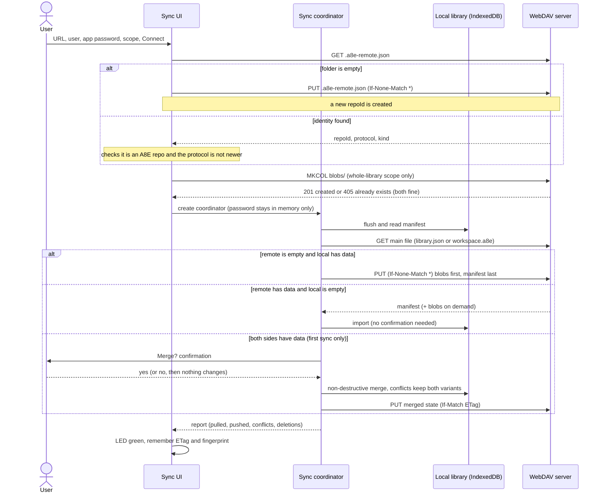
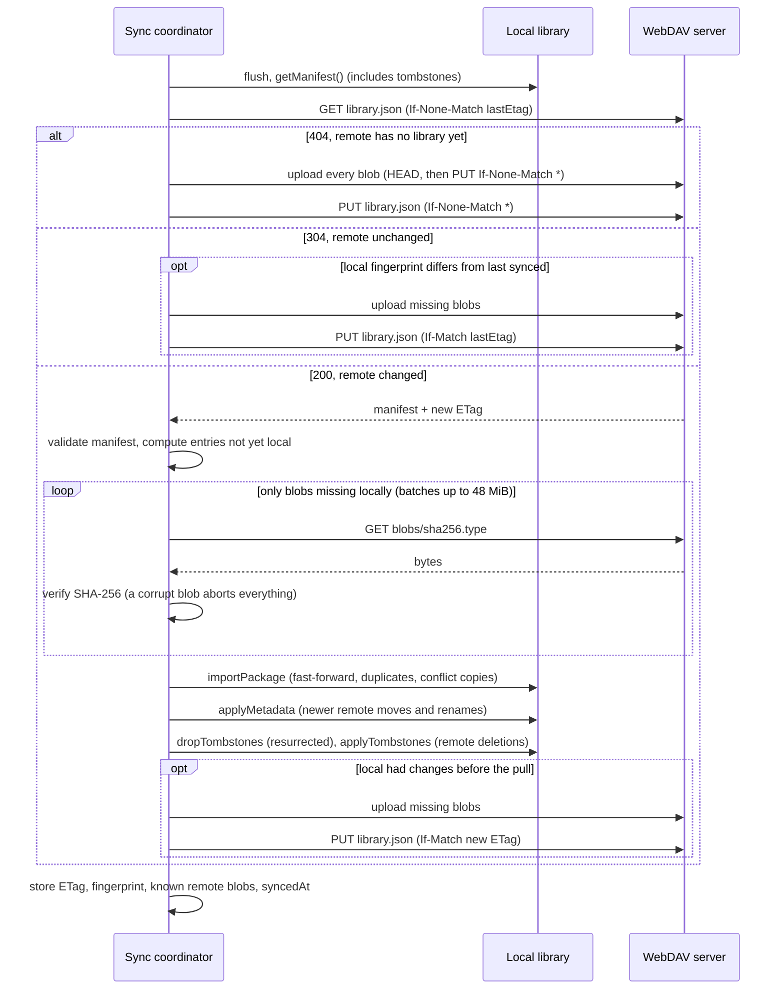
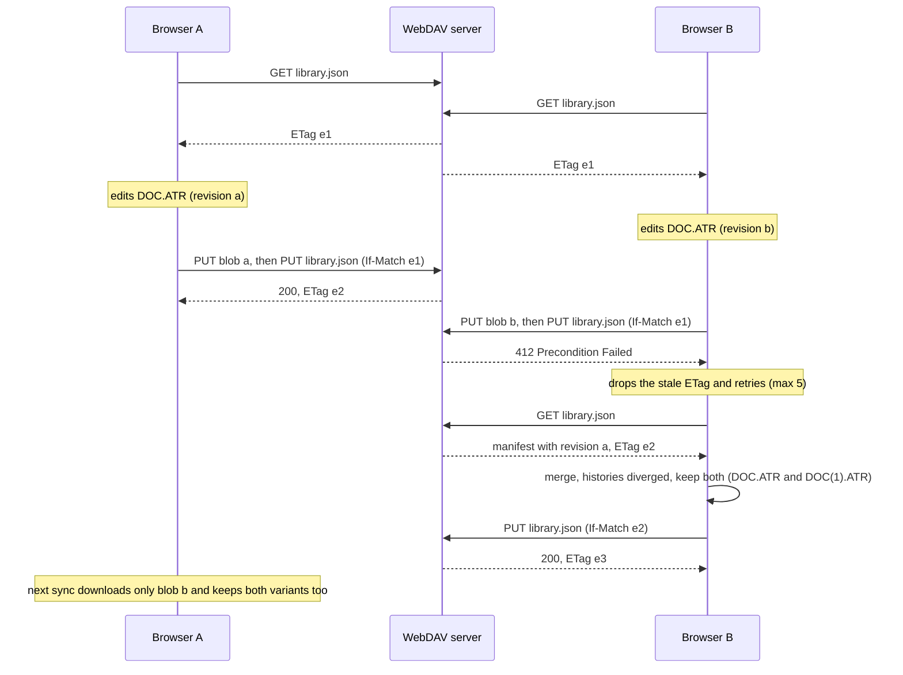
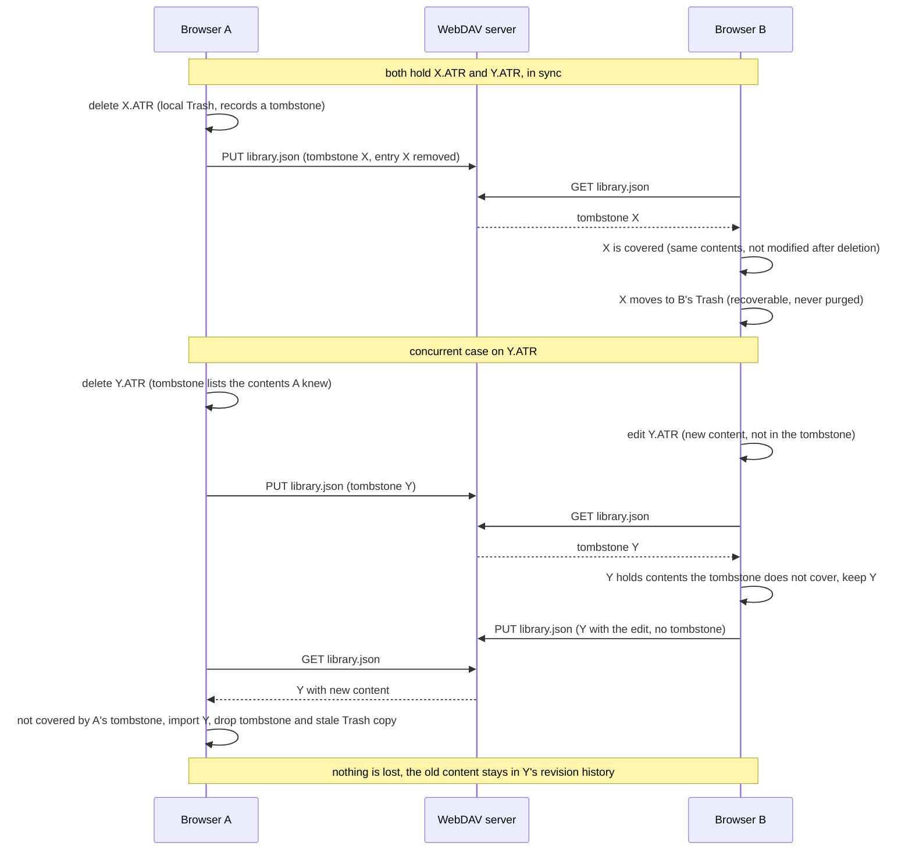
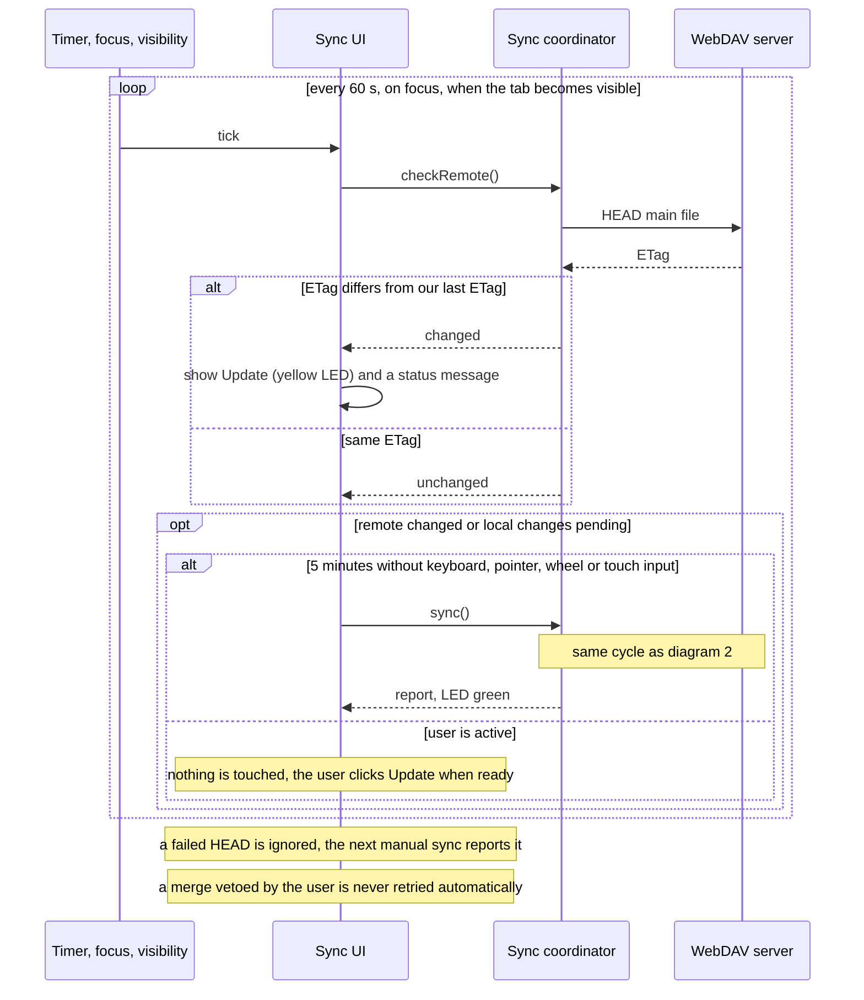
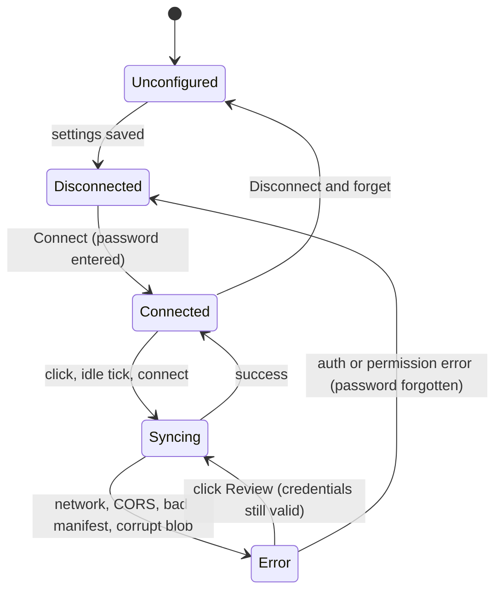
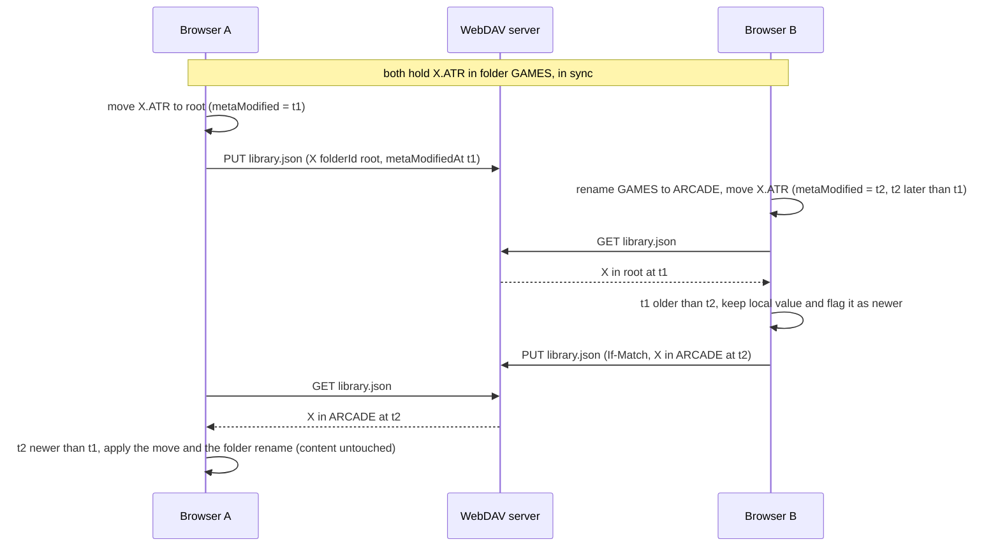

# Online Drive: remote synchronization of the Disk Library

Status (jsA8E, branch `OnlineDrive`):

| Phase | Scope | Status |
|---|---|---|
| 1 | Workspace sync (`workspace.a8e`, mounted disks only) | Implemented, validated on a real Nextcloud (Firefox + Chromium) |
| 2a | Whole-library incremental sync (`library.json` + `blobs/`) | Implemented, validated on a real Nextcloud (2026-11-09; the proxy must allow `MKCOL` in CORS) |
| 2b | Deletions through tombstones | Implemented, validated on a real Nextcloud (delete, edit-beats-delete) |
| 2b | Renames / moves (entry folder and name, folder name) | Implemented, covered by unit tests, pending real-server validation |
| 3 | Automatic sync (ETag polling, "Update" indicator, idle sync) | Implemented in jsA8E; polling covered by unit tests, UI timers not covered by automated tests |
| 3b | Remote cleanup (blob GC), remember-password opt-in with auto-reconnect, gamepad idle detection, hash cache, stale-worker hint | Implemented in jsA8E, covered by unit tests where logic is testable (cleanup, hash cache); pending real-server validation |
| - | Native A8E WebDAV client | Not started (accepted parity debt, see "Native parity" for the blocker) |

## Where things live

| Piece | Location |
|---|---|
| WebDAV client, workspace sync, fingerprint, `checkRemote` | `jsA8E/js/app/remote_workspace.js` |
| Whole-library sync (blobs, tombstones, metadata merge) | `jsA8E/js/app/remote_library.js` |
| Control, LED, dialog, polling and idle timers | `jsA8E/js/app/remote_sync_ui.js` (markup in `index.html`, styles in `style.css`) |
| Library core support (`getManifest`, `readBlob`, tombstones, `applyMetadata`, fast-forward import) | `jsA8E/js/core/disk_library.js`, `library_package.js` |
| Worker bridge | `jsA8E/js/core/app_proxy.js`, `jsA8E/emulator_worker.js` |
| Tests | `remote_workspace`, `remote_library`, `remote_library_tombstones`, `remote_library_metadata` (+ `remote_test_support.js`, a simulated ETag/MKCOL/Basic-auth server), `app_proxy_library_export`, `disk_library_api_parity` |

## Decisions (2026-11-08)

- Start with the **workspace MVP** (a single `workspace.a8e`), then grow.
- **Tombstones** were designed up front and implemented in Phase 2b: the MVP
  only carries mounted disks, so there were no deletions to propagate yet.
- **Web first, native later.** The parity gap with native A8E is explicitly
  accepted until the native adapter exists (see "Native parity").
- Real validation is done against the author's own Nextcloud (shared folder,
  application password).

## Problem and scope

The Disk Library of jsA8E lives in the local storage of each browser. Exporting
and importing `.a8e` packages works, but using several browsers means carrying
the newest package by hand and remembering which copy is current. The goal is
an **optional** remote peer of the local library:

```text
local IndexedDB  <---- synchronization ---->  WebDAV repository
```

The local library stays the working copy and works offline. The remote is not a
second "online" section of the Library nor a public/shared collection (that
would be a different product).

Two scopes exist:

- **Mounted disks only** (workspace): one `workspace.a8e` package.
- **Whole library**: entries, folders and revisions, transferred incrementally.

## Behavior at a glance (sequence diagrams)

HTTP is the transport and WebDAV is the server dialect: the browser only uses
`GET`, `HEAD`, `PUT` and (once, whole-library scope) `MKCOL`. There is no
`PROPFIND`.

### 1. Connect and first sync



### 2. One sync cycle (whole-library scope)



### 3. Two browsers publish at the same time (precondition failure)



### 4. Deletions and tombstones (an edit always beats a delete)



### 5. Automatic mode (polling, Update indicator, idle sync)



### 6. Control states



While `Connected`, a local change marks the control *Pending* and a remote
change marks it *Update* (both yellow LED); a successful sync clears both.

## Remote format

```text
<WebDAV folder>/
├── .a8e-remote.json   {format:"a8e-remote", protocol:1, kind, repoId}
├── workspace.a8e      workspace scope: existing ZIP package (mounted disks + folder ancestry)
├── library.json       whole-library scope: schema-v1 manifest (+ optional "tombstones")
└── blobs/
    └── <sha256>.<atr|xex>   immutable, content-addressed payloads
```

- `.a8e-remote.json` identifies the repository so a local configuration cannot
  point at another compatible folder by accident. It never holds secrets or
  local paths. The two scopes can live in the same folder.
- Blobs are immutable and deduplicated: a new revision is a new hash; the
  content of another revision is never overwritten.
- `library.json` keeps the existing exchange contract. `tombstones` is an
  optional field that older readers ignore.
- The WebDAV folder must exist; A8E does not create it.

## Synchronization principles

- No "last writer wins". Every write is guarded by `If-Match` (publish) or
  `If-None-Match: *` (create). `412`/`409` means someone published first: drop
  the stale ETag, download, merge, retry (max 5).
- Merging reuses the Library's non-destructive import: identical content is a
  duplicate, a descendant revision fast-forwards, divergent histories keep both
  variants (`DOC.ATR`, `DOC(1).ATR`). A merge never discards a variant.
- Sector writes never trigger network traffic: the emulator persists locally
  first, and syncing is manual or idle-driven.
- Dirty detection uses a deterministic **fingerprint** of the manifest
  (entries, folders, revision ids/hashes, devices, write protection,
  tombstones; no timestamps), because `libraryVersion` is a local counter that
  only increments on import.
- The manifest is published **last**, after its blobs, so the remote never
  references a missing blob.
- First connection never replaces anything implicitly: an empty remote is
  published to, an empty library is filled from the remote, and when both have
  data the user confirms a non-destructive merge.

## Credentials and security

A static web app has no secret store comparable to the OS keychain. A password
kept in IndexedDB/localStorage is readable by same-origin JavaScript (including
a possible XSS), so it is not considered secure storage.

- An **application password** (Nextcloud: Settings, Security) is asked each
  session and kept only in memory.
- Only URL, user, scope, auto-sync preference, `repoId`, last ETag/fingerprint,
  `syncedAt` and the known remote blob list are persisted (localStorage key
  `a8e.remoteWorkspace.v1`).
- No secrets in `.a8e`, `library.json`, snapshots or diagnostics.
- HTTPS is required (only `localhost`, `127.0.0.1` and `[::1]` may use `http`);
  credentials inside the URL are rejected; requests use `credentials: "omit"`
  and `redirect: "error"` with a manual `Authorization: Basic` header.
- By default, after a reload the control returns to "Connect" because the
  password is not persisted.
- **Opt-in "Remember the password on this device"** (dialog checkbox, off by
  default): stores the password **unencrypted** in `localStorage` (same key as the
  settings) and reconnects and syncs automatically when the page loads. Anyone
  with access to the browser profile, or any script running in this origin,
  can read it, so only use a revocable application password. The password is
  deleted when the box is cleared and Connect is pressed again, on "Disconnect
  and forget", and automatically if the server rejects it. A backend with an
  `HttpOnly` session, or OAuth/OIDC with PKCE, would be safer but needs extra
  infrastructure.

## Server requirements: CORS and Nextcloud

CORS is enforced by the browser, not by WebDAV, so opening the WebDAV URL in a
tab proves nothing. The browser sends a preflight (`OPTIONS`) because of
`Authorization`, `If-Match`, `If-None-Match` and `Content-Type`. The server
must answer for the jsA8E origin:

```text
Access-Control-Allow-Origin:   https://<jsA8E origin>   (or http://localhost:<port>)
Access-Control-Allow-Methods:  GET, HEAD, PUT, MKCOL, DELETE, OPTIONS
Access-Control-Allow-Headers:  Authorization, If-Match, If-None-Match, Content-Type
Access-Control-Expose-Headers: ETag
```

- `MKCOL` is only needed by the whole-library scope (creates `blobs/` once; a
  `405` on later runs is normal and is treated as success, although the browser
  console shows it).
- `DELETE` is only needed by "Clean up remote" (see Remote cleanup); everything
  else works without it. `Last-Modified` is a CORS-safelisted response header and
  needs no `Expose-Headers` entry.
- Do not send `Allow-Credentials`: the client omits credentials and sends
  `Authorization` itself.
- Nextcloud/ownCloud do not add these headers for arbitrary origins: add them
  in the reverse proxy (nginx/Apache) for `/remote.php/dav/`, answering
  `OPTIONS` without authentication with 204, or use a CORS app. A simple setup
  is serving jsA8E from the same server as Nextcloud.
- Typical Nextcloud URL: `https://server/remote.php/dav/files/<user>/A8E/`.
- **Deployments:** upload `emulator_worker.js` together with `js/`, and reload
  without cache. A stale cached worker answers `Unknown worker request` to the
  newer proxy messages (neither the worker nor the scripts are version-busted).
  The sync dialog recognizes that error and adds "the emulator worker is out of
  date: reload without cache". The durable fix is server-side: send
  `Cache-Control: no-cache` (revalidate) for `.js` files and the worker.

Connection diagnosis (`client.connect()`): invalid or non-HTTPS URL, credentials
in the URL, network/CORS failure (the browser cannot tell them apart and the
message says so), `401` rejected authentication, `403` no permission, missing
folder (`404`/`405` on upload), ETag not exposed by CORS (`no-etag`), a folder
whose `.a8e-remote.json` is not an A8E repo, and a newer protocol.

### Nextcloud test plan

1. Create the folder and an application password.
2. Configure CORS for the test origin and open jsA8E (or `localhost`).
3. *Connect*: `.a8e-remote.json` must appear. Verify the server returns and
   exposes `ETag` on `GET`/`PUT` and honors `If-Match` and `If-None-Match: *`.
4. Workspace scope: mount a disk in D1, *Sync*, `workspace.a8e` must appear.
5. Whole-library scope: `blobs/` appears, a new disk uploads exactly one blob.
6. Second browser or profile: *Connect* + *Sync* must bring everything. Edit on
   one side and sync both, then edit on both sides and sync.
7. Delete a disk in one browser and sync both: it must land in the other
   browser's Trash. Edit it in one browser and delete it in the other before
   syncing: the edit must survive.
8. Automatic mode: edit in one browser and sync; in the other the control must
   show *Update* within a minute (or when the tab regains focus), and after 5
   idle minutes it must update by itself.
9. "Remember the password": tick it, Connect, reload the page: it must
   reconnect and sync by itself; a wrong stored password must be discarded.
10. "Clean up remote" (library scope, DELETE allowed in CORS): delete and purge a
    disk, sync, then clean up; blobs older than 7 days that nothing references
    disappear and referenced ones stay.

## Phase 1: workspace sync

Files: `js/app/remote_workspace.js` (client and sync, no DOM),
`js/app/remote_sync_ui.js` (control, LED, dialog), `tests/remote_workspace.test.js`.
It only uses `fetch` and the public Disk Library API (`flush`,
`exportWorkspacePackage`, `previewImport`, `importPackage`), so it works with or
without the worker.

`sync()`:

1. `library.flush()` and export of the local workspace; compute the fingerprint.
2. `GET workspace.a8e` with `If-None-Match`: `404` publishes if there are
   mounted disks; the same ETag publishes only if the fingerprint changed; a new
   ETag downloads and merges (`previewImport` + `importPackage`), asking for
   confirmation on the first sync with data on both sides, then republishes if
   the local side had changes.
3. `412`/`409` on upload: retry up to 5 times. Never overwrite.
4. Store ETag, fingerprint and time.

Consequences:

- Only **mounted** disks travel (D1-D4 in the UI).
- If two browsers edited the same disk, each side keeps both variants as
  separate entries; the variant of each side stays mounted.
- A pull restores the remote mounts (`mountFile`), hence the `flush()` first.
- `replaceFile` unmounts a mounted entry, so a replaced and not remounted disk
  leaves the workspace.
- No incremental transfer (every publish uploads the whole workspace) and no
  deletions to propagate.

## Phase 2a: whole-library incremental sync

Files: `js/app/remote_library.js`, the "What to synchronize" selector in the
dialog, `tests/remote_library.test.js` and `tests/remote_test_support.js` (the
shared simulated server). Switching scope resets that connection's sync state.

Algorithm (diagram 2):

1. `library.getManifest()` (no bytes, no mounts) and `GET library.json`.
2. Remote missing: publish everything. Remote unchanged: publish only if the
   fingerprint changed.
3. Remote changed: validate the manifest with the importer's validator, compute
   the entries the library lacks (unknown id, or different revisions/hash) and
   download **only the blobs whose SHA-256 is missing locally**, verifying each
   one on arrival (a corrupt or missing blob aborts without importing anything).
   Entries are imported in batches of at most 48 MiB by assembling an in-memory
   `.a8e` and using the existing `importPackage`, so validation, atomicity and
   conflict policy are the same. Local blobs are read with `library.readBlob`.
4. Publish: for every blob the remote lacks, `HEAD`, then `PUT` with
   `If-None-Match: *`; finally `PUT library.json` with `If-Match`. The set of
   known remote blobs is stored (`remoteBlobs`) to avoid repeated `HEAD`s.
5. Mounts are **not** synchronized in this scope (they are per browser).

### Core change: fast-forward

`planImport` used to treat any entry with the same id and different content as
a conflict, even when it was a later edit of the same disk, so "edit on A, sync
on B" created a `(1)` copy. It now uses the revision graph:

- local current content is a retained revision of the imported entry:
  **fast-forward** (add the new revisions, advance the content, keep the mounted
  drive; `summary.fastForwarded`);
- imported content is already a retained local revision: older history,
  reported as a duplicate;
- anything else (diverged branches): conflict, `(1)` copy as before.

This implements the "a descendant is preferred to its ancestor" rule of
`full_library.md`. It also affects manual import and workspace sync. **Native
A8E does not have it yet** (parity debt).

### New Disk Library APIs (core and worker proxy)

`getManifest()`, `readBlob(sha256)`, `getTombstones()`, `applyTombstones(list)`,
`dropTombstones(ids)` and `applyMetadata(remote)`, with worker messages
`diskLibraryManifest`, `diskLibraryReadBlob`, `diskLibraryTombstones`,
`diskLibraryApplyTombstones`, `diskLibraryDropTombstones` and
`diskLibraryApplyMetadata`. `disk_library_api_parity.test.js` also scans the
remote modules for methods they use. The proxy side is covered by
`app_proxy_library_export.test.js`; `emulator_worker.js` itself has no direct
automated test (manual use in Chromium exercises it).

## Phase 2b: deletions with tombstones

Problem: without a deletion record, a local delete is resurrected by the next
merge with a remote that still holds the item. Solution (schema-v1 compatible,
optional field):

```json
"tombstones": [
  { "kind": "entry",  "id": "disk-docs", "deletedAt": 1731067200000,
    "shas": ["<sha256 of every content the entry held when deleted>"] },
  { "kind": "folder", "id": "folder-games", "deletedAt": 1731067200000 }
]
```

- Stored under the key `tombstones` of the IndexedDB `metadata` store (no
  `DB_VERSION` bump). `deleteFile` and `deleteFolder` create them,
  `restoreTrash` removes them. Emptying the Trash does **not** remove them (the
  deletion stays in force). `getManifest()` emits them and the fingerprint
  includes them (appended only when present, so older fingerprints stay valid).
- An entry is **covered** by a tombstone when all its contents are in `shas`
  **and** its `modified` is before `deletedAt`. A later edit, move or restore
  takes it out of that case: the change wins, so a concurrent delete can never
  lose an edit.
- Remote tombstone and covered local entry: the entry moves to the **local
  Trash** (recoverable). A remote deletion never purges bytes.
- Local tombstone and covered remote entry: not imported. If not covered, it is
  imported, the tombstone is dropped and the stale Trash copy is purged (its
  content is an ancestor of the live entry and stays in the revision history).
- A folder tombstone deletes the folder only if it ends up empty; a locally
  deleted folder is not re-imported unless a downloaded entry lives in it.
- Restoring bumps `modified`, so other browsers see the restore as a later
  change and recover the entry.
- Tombstones expire after 90 days (`TOMBSTONE_TTL_MS`); a browser offline longer
  than that could resurrect deleted items.
- Blobs of deleted entries are not removed from the remote (no remote GC).
- The comparison uses browser clocks (`modified` vs `deletedAt`); a large skew
  can make a delete or an edit win wrongly, without data loss because every
  deletion goes to the Trash.
- Remote folders the library lacks (even empty ones) are now merged too.
- Test: `tests/remote_library_tombstones.test.js`.

### Renames and moves (metadata merge)

What the library can actually change: moving an entry to another folder
(`moveFile`), renaming a folder (`renameFolder`), and a different name that
comes with a replacement (`replaceFile`). There is no folder move and no
standalone entry rename in the UI, so those are not handled.

- Each entry has a `metaModified` timestamp (persisted, exported in the manifest
  as the optional `metaModifiedAt`) set by `moveFile`, by `replaceFile` when the
  name changes and by `restoreTrash`. It is separate from `modified` (content
  and any change) on purpose: an unrelated later edit on another browser must not
  undo a move. Folders already carry `modified`, which only changes on rename.
- `library.applyMetadata({entries, folders})` (core, proxy and worker) applies a
  remote change only when the remote timestamp is **newer** than the local one:
  the newest change wins and content is never touched. The remote timestamp is
  adopted (not "now"), so applying a change never counts as a new local edit.
- Safeguards: a move or rename is skipped when it would create a duplicate name
  in the target folder, when the target folder does not exist, or (entries) when
  the new name has a different format extension. Nothing is ever merged or
  overwritten.
- When the local value is newer than the remote one (it was kept), the sync
  republishes so the other browser receives it (`metaNewer`). Equal values are
  not counted, so two idle browsers cannot ping-pong.
- Remote folders that already exist locally are handed to the importer with the
  **local** name, otherwise a renamed folder was imported as a duplicate
  (`<id>-import`) whenever an entry was pulled in the same round.
- Test: `tests/remote_library_metadata.test.js` (move, folder rename, rename plus
  edit in the same round without duplicating the folder, newest move wins).



## Phase 3: automatic sync

An option in the dialog, "Check the remote automatically; sync after 5 minutes
without activity" (on by default, saved as `auto`, applied on the next
*Connect*). It only acts while the connection is established in this session
(diagram 5).

- **Change marker = the ETag** of the main file (`library.json` or
  `workspace.a8e`). `checkRemote()` sends a `HEAD` (no body) and compares with
  the last own ETag. There is no "last updated" field, which avoids clock skew.
- **Triggers:** every 60 s, on window focus and when the tab becomes visible. A
  network failure while polling is ignored; the manual sync diagnoses it.
- **Remote change detected:** the control shows *Update* (yellow LED) and a
  status message. Nothing is touched while the user is active.
- **Idle:** after 5 minutes without keyboard, pointer, wheel or touch input the
  pending sync (pull and/or push) runs by itself. A merge the user vetoed is not
  launched again automatically.
- Gamepad activity counts as activity: while connected, the pads are sampled
  every 2 s (any pressed button or an axis beyond 0.5) because gamepads raise no
  DOM events. In whole-library scope mounts are untouched, and a fast-forward of
  a mounted disk keeps its drive.

### Remote cleanup (blob garbage collection)

Blobs of deleted (and purged) entries stay on the server, because without
`PROPFIND` the client cannot list the folder. The dialog button **Clean up
remote** (whole-library scope, while connected) runs
`sync.collectGarbage({minAgeMs})`:

- Candidates are only the blobs this client knows (`remoteBlobs`: uploaded by
  it or seen in a manifest it pulled) that neither the **current remote
  manifest** nor the **local manifest** reference (so a local entry not yet
  published is safe).
- A blob younger than 7 days (`Last-Modified` from `HEAD`) is kept, so another
  browser that just uploaded blobs for a publish still in flight cannot lose
  them. A server that sends no `Last-Modified` gets no age protection.
- The type of an unreferenced blob is not recorded, so `blobs/<sha>.atr` and
  `.xex` are both tried (`HEAD`, then `DELETE`).
- Manual on purpose and behind a confirmation: it is the only operation that
  deletes remote data. A restore or a re-add simply uploads the blob again.
- Needs `DELETE` in the server CORS methods.

### Hash cache

`getManifest()` no longer rehashes the whole history on every sync. Retained
revisions are immutable, so their SHA-256 is cached per byte array in a
`WeakMap` (`hashOfRevision`) and passed to `makeManifest` (`revisionHash`
option); only each entry's current bytes are hashed fresh. The same rule fixed a
latent bug in `readBlob` and the tombstone hashes: the current bytes of a mounted
disk are mutated in place by sector writes, so caching their hash could return a
stale value and break an upload with "local blob unavailable".

## User interface

Right end of the Disk Library panel title bar: LED + button (`Configure`,
`Connect`, `Sync`, `Update`, `Syncing`, `Review`) and a gear that opens the
dialog (URL, scope, user, application password, auto option). The LED reuses
`assets/leds.png` and is also shown as a badge on the toolbar Disk Library
button and the mobile `Disks` entry. Tooltip and `aria-label` carry the detail
("synchronized 3 min ago", "local changes pending", the error text). The control
sits in the title bar, not in the toolbar, because the toolbar row already
holds the file actions and is horizontally dense.

| LED | State |
|---|---|
| Grey | Not configured, or not connected this session |
| Solid green | Connected and in sync |
| Pulsing green | Sync in progress |
| Solid yellow | Local changes pending, or the remote changed (*Update*) |
| Pulsing red | Error or conflict needing attention |

The existing media activity LED keeps its own meaning (green reads, yellow SIO
writes) and is never reused for network traffic. The visible Library UI uses the
classic four-drive view (`D1:` to `D4:`); sync controls are never mixed with the
drive slots.

## Known limitations and next steps

The remaining candidate is the native client (see "Native parity").

- Renames and moves use browser clocks (newest change wins); there is no folder move and no standalone entry rename to merge.
- Remote cleanup is manual and age-protected only when the server sends
  `Last-Modified`; tombstones expire after 90 days.
- `getManifest()` still hashes each entry's current bytes once per sync (the
  revision history is cached).
- Workspace scope: whoever merges a diverged branch keeps their edit plus a `(1)`
  copy of the remote one, and the edit of the other side only travels if mounted.
- `emulator_worker.js` handlers and the UI (timers, gamepad sampling, remembered
  password reconnection, cleanup button) have no direct automated test.

## Native parity

**Blocker to decide:** the native emulator needs an HTTPS client, and the project
rule is "no external dependencies". The C standard library has no TLS, and
writing TLS 1.2/1.3 from scratch is large and security-sensitive. The realistic
options are (a) use the operating system's own stack (WinHTTP/SChannel on
Windows, Network.framework or CFNetwork on macOS; Linux has no built-in one),
(b) accept a system TLS library (OpenSSL/libcurl/mbedTLS) as a documented
exception to the rule, or (b') talk plain `http` only to a local reverse
proxy or loopback. None of this has been started.

Only the web version is delivered. To declare parity with the Full Library,
native A8E needs a dependency-free HTTPS WebDAV client using the same layout,
the same `.a8e-remote.json`, the same ETag/If-Match rules, the fast-forward
logic in `planImport`, tombstones and shared fixtures. Meanwhile native A8E can
import and export the same `workspace.a8e` manually. The parity debt is also
tracked in `full_library.md`.
